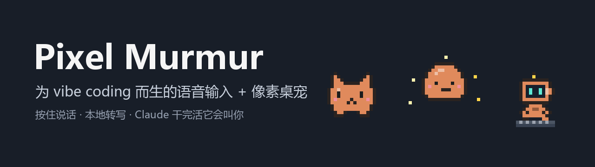
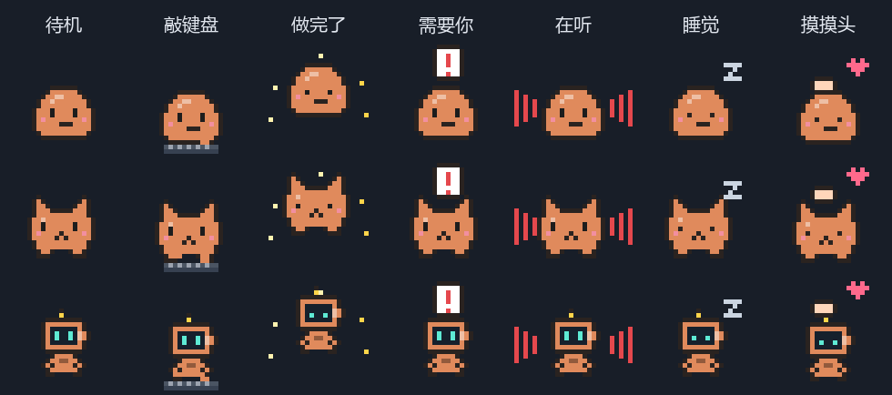
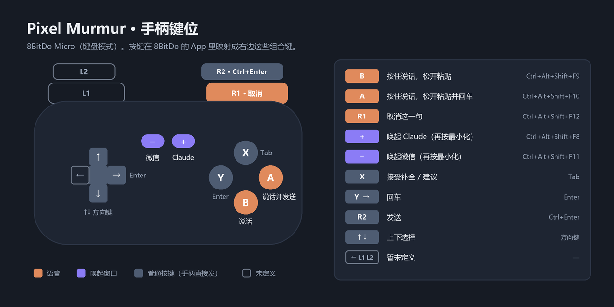
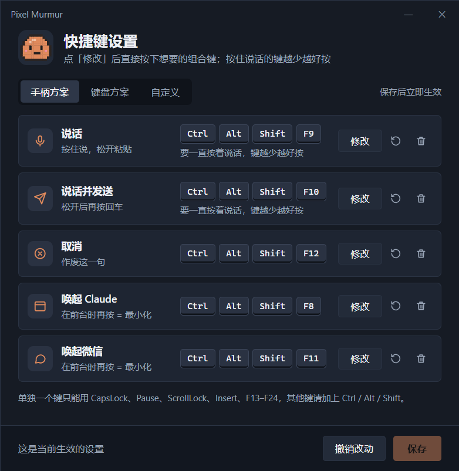
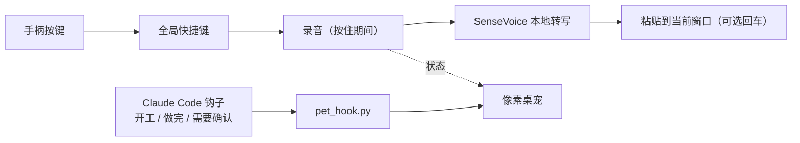

<p align="center">
  
</p>

<p align="center">
  
  
  
  
</p>

# Pixel Murmur

**为 vibe coding 而生的语音输入 + 像素桌宠。**

和 AI 一起写代码时，大部分时间你都在「描述需求」和「等它干完」。Pixel Murmur 把这两件事都变轻松：

- **按住说话，松手就发。** 握着手柄按住一个键说话，松开后文字直接贴进 Claude 的输入框，愿意的话还能顺手回车发送。语音在本机 CPU 上转写，一句话大约 0.05 秒出字，**不联网、不上传**。
- **不用盯着屏幕等。** 屏幕角落住着一只像素小家伙：Claude 开工时它敲键盘，干完活它跳起来叫你，需要你确认时它头顶冒出「!」。
- **靠在椅子上就能工作。** 说话、发送、Tab、回车、切到 Claude / 微信，全在一个手柄上。

<p align="center">
  
</p>

## 桌宠

三个原创像素角色可选：**团子**、**小猫**、**小机器人**。颜色、大小、动画速度都能调。

<p align="center">
  
</p>

| 什么时候 | 桌宠会 |
|---|---|
| 平时 | 呼吸起伏、偶尔眨眼；几分钟没动静就睡觉冒 z |
| 你按住说话 | 两侧冒出声波，旁边弹出录音胶囊（计时 + 音量格），松开后显示「转写中…」→「已粘贴」 |
| 你给 Claude 发了消息 | 抱着小键盘敲字，直到 Claude 做完 |
| Claude 做完 | 跳起来冒星星，「叮」一声，气泡里显示回复的第一句 |
| Claude 需要你确认 | 头顶冒「!」左右晃，「叮咚」一声；单击它或你回复后消失 |
| 你单击它 | 被摸摸头（小手拍拍、眯眼、冒一颗心），同时把 Claude 切到前台 |

- **拖动**换位置，重启后还在原处；在屏幕哪一侧，胶囊和气泡就往另一侧展开。
- **右键**打开菜单：每种提醒单独开关、查看用量、录音颜色、快捷键设置…、复位到右下角、打开配置 / 日志、退出。
- 拖动、单击、右键都**不会抢走**你正在打字的窗口的焦点。

## 推荐硬件

| | 我在用的 | 替代 |
|---|---|---|
| 手柄 | 8BitDo Micro（键盘模式） | 任何能把按键映射成键盘组合键的手柄或宏键盘 |
| 麦克风 | 大疆无线麦克风 | 任何麦克风；电脑自带的也能用 |

没有手柄也完全能用，见下面的[只用键盘](#只用键盘快捷键设置)。

### 手柄键位（8BitDo Micro，供参考）

<p align="center">
  
</p>

| 手柄 | 发出的按键 | 作用 |
|---|---|---|
| **B**（按住） | Ctrl+Alt+Shift+F9 | 说话，松开后粘贴 |
| **A**（按住） | Ctrl+Alt+Shift+F10 | 说话，松开后粘贴并回车（直接发送） |
| **R1** | Ctrl+Alt+Shift+F12 | 取消这一句 |
| **+** | Ctrl+Alt+Shift+F8 | 唤起 Claude；已在前台时再按 = 最小化 |
| **−** | Ctrl+Alt+Shift+F11 | 唤起微信；已在前台时再按 = 最小化 |
| **X** | Tab | 接受补全 / 建议 |
| **Y**、**→** | Enter | 回车 |
| **R2** | Ctrl+Enter | 发送 |
| **↑ / ↓** | 方向键 | 上下选择 |

手柄那头在 8BitDo 的 App 里把按键映射成上面这些组合键；电脑这头的组合键可以在「快捷键设置」里改。

## 只用键盘：快捷键设置

右键桌宠 →「**快捷键设置…**」打开设置窗口。点「修改」后直接按下想要的组合键就能录进去，保存后立即生效，不用重启。

<p align="center">
  
</p>

顶部可以一键套用两套方案，之后还能逐个改：

| 功能 | 手柄方案 | 键盘方案 |
|---|---|---|
| 说话（按住） | Ctrl+Alt+Shift+F9 | **CapsLock** |
| 说话并发送（按住） | Ctrl+Alt+Shift+F10 | Shift+CapsLock |
| 取消 | Ctrl+Alt+Shift+F12 | Ctrl+CapsLock |
| 唤起 Claude | Ctrl+Alt+Shift+F8 | Ctrl+Alt+C |
| 唤起微信 | Ctrl+Alt+Shift+F11 | Ctrl+Alt+W |

- 键盘方案用 CapsLock「按住说话」：在小拇指边上，键大好按，平时也很少用。被占用后它不会再切换大小写（程序会自动把状态切回来），要打大写请按住 Shift。
- 单独一个键只能用 CapsLock、Pause、ScrollLock、Insert、F13–F24；其他键必须带 Ctrl / Alt / Shift，免得拦住平时打字。和输入法、系统冲突的组合（如 Ctrl+Space、Alt+Tab）会直接提示不能用。
- 录入时会检查是否和其他功能重复、是否已被别的程序占用。微信默认就占用了 Ctrl+Alt+W（它本身也能唤起微信），遇到这个提示可以直接清空「唤起微信」这一项。
- 新电脑运行安装时，第一步会问你用手柄还是键盘，选键盘就直接套用键盘方案。

## 安装

需要 Windows 10/11、[Python 3.12 或 3.13](https://www.python.org/downloads/)（安装时勾选 “Add to PATH”）和 Git。

```powershell
git clone https://github.com/APieceOfToast123/pixel-murmur C:\pixel-murmur
```

然后双击 `C:\pixel-murmur\install.bat`，它会依次：

1. 建虚拟环境并安装依赖；
2. 问你用手柄还是键盘（选键盘就套用键盘方案），再列出麦克风让你输入编号选一个；
3. 自动找到微信的安装位置；
4. 把桌宠的钩子合并进 `~/.claude/settings.json`（原文件先备份到 `backup\`，你已有的设置和钩子都保留）；
5. 设好开机自启，并在后台启动。第一次启动会下载 SenseVoice 语音模型（约 160 MB）。

装好后打开记事本，按住「说话」键（手柄 B / 键盘方案 CapsLock / 默认 Ctrl+Alt+Shift+F9）说一句话，松开，就会出字。

想重新选麦克风或重新挂钩子，随时再运行：

```powershell
C:\pixel-murmur\.venv\Scripts\python C:\pixel-murmur\pixel_murmur.py --setup
```

更新到最新版：在 `C:\pixel-murmur` 里运行 `git pull`，然后右键桌宠选「退出」再重新启动（或者重启电脑）。

## 它是怎么工作的



- **语音输入**：用系统的 `RegisterHotKey` 注册全局快捷键，按住期间录音，松开后用 [sherpa-onnx](https://github.com/k2-fsa/sherpa-onnx) 跑 SenseVoice 模型转写，再通过剪贴板粘贴，原来的剪贴板内容会还原。
- **桌宠**：一个透明、置顶、不抢焦点的分层窗口，用 Pillow 逐帧画像素。
- **Claude 联动**：Claude Code 的 `UserPromptSubmit` / `Stop` / `StopFailure` / `Notification` 钩子会调用 `pet_hook.py`，它把事件转发给桌宠。桌宠没开时钩子什么也不做。

## 配置

| 文件 | 内容 | 是否同步 |
|---|---|---|
| `config.toml` | 所有电脑共用的默认值：快捷键、提示音、桌宠外观、模型参数等 | 随仓库同步 |
| `config.local.toml` | 只跟这台电脑有关的：麦克风名字、微信路径、右键菜单里改的颜色和开关 | 不上传 |
| `ui_state.json` | 桌宠的位置 | 不上传 |

常调的几项：

| 项 | 默认 | 说明 |
|---|---|---|
| `[pet] character` | `"blob"` | `blob` 团子 / `cat` 小猫 / `bot` 小机器人 |
| `[pet] body_color` | `"#E08A5C"` | 身体颜色 |
| `[pet] pixel_size` | `4` | 像素块大小，建议 2–6 |
| `[pet] sleep_minutes` | `5` | 多久没动静就睡觉 |
| `[feedback] beep_volume` | `0.08` | 录音开始 / 结束提示音的音量 |
| `[pet] sound_volume` | `0.3` | 桌宠提示音的音量 |
| `[replacements]` | 空 | 识别后的固定替换，用来纠正总认错的词 |

改完右键桌宠选「退出」，再重新启动即可生效。

## 隐私

- 语音只在你的电脑上转写，不上传到任何地方。唯一一次联网是第一次启动时从 GitHub 下载语音模型。
- 日志里默认会记录识别出的文字，方便排查；不想记录就把 `[feedback] log_text` 设成 `false`。
- 剩余额度：桌面版 Claude 没有官方读取方式，所以桌宠不显示额度数字，右键「查看用量」会直接打开官方的用量页面。

## 常见问题

- **按了没反应 / 快捷键注册失败**：组合键被别的程序占了，右键桌宠「快捷键设置…」换一个。
- **粘贴不进去**：前台程序如果是以管理员身份运行的，普通权限的程序没法给它发按键；这时文字会留在剪贴板里，手动粘贴即可。
- **微信里贴出的是旧内容**：剪贴板还原得太早，调大 `[paste] restore_delay`。
- **总是认错某个术语**：在 `[replacements]` 里加一条，比如 `"克劳德" = "Claude"`。
- **桌宠找不到了**（比如跑到拔掉的副屏上）：右键菜单「复位到右下角」，或者重启程序。
- **Claude 做完了桌宠没反应**：确认 `~/.claude/settings.json` 里有 `pet_hook.py` 的钩子；钩子在会话开始时读取，改完要新开一个会话。
- **日志在哪**：`logs\pixel_murmur.log`，右键菜单里可以直接打开。

## 其他命令

```powershell
.venv\Scripts\python pixel_murmur.py --hotkey-settings       # 打开快捷键设置窗口
.venv\Scripts\python pixel_murmur.py --list-devices          # 列出麦克风
.venv\Scripts\python pixel_murmur.py --transcribe 录音.wav    # 单独测一段录音的转写速度
.venv\Scripts\python pixel_murmur.py --remove-autostart      # 取消开机自启
```

## 许可证

[MIT](LICENSE)。本项目与 Anthropic 无关，不是 Claude 的官方产品；「Claude」是 Anthropic 的商标。
